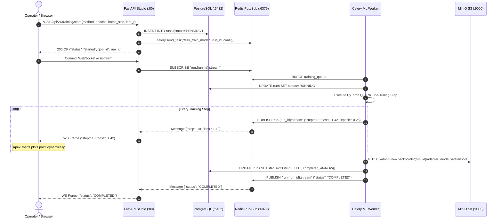

# Communication Protocols & Sequences

Details of inter-container communication, protocol schemas, and end-to-end task flows.

---

## 1. Inter-Service Communication Matrix

| Source | Destination | Transport | Protocol | Auth | Purpose |
| :--- | :--- | :--- | :--- | :--- | :--- |
| **Browser** | `doctune-web` | TCP | HTTP/1.1 | Session / Local | UI pages, REST API requests |
| **Browser** | `doctune-web` | TCP | WebSocket | None (Local) | Real-time log & loss curve streaming |
| **Browser** | `doctune-minio` | TCP | HTTPS/S3 | Presigned URL | Direct model artifact download |
| `doctune-web` | `doctune-postgres` | TCP | PostgreSQL Wire | User/Password | Reading & persisting runs and metadata |
| `doctune-web` | `doctune-redis` | TCP | RESP | None (Internal) | Enqueuing Celery tasks & Pub/Sub subscription |
| `doctune-worker`| `doctune-redis` | TCP | RESP | None (Internal) | Consuming tasks & publishing metrics |
| `doctune-worker`| `doctune-minio` | TCP | S3 REST (boto3) | S3 v4 HMAC | Uploading checkpoints & downloading datasets |
| `doctune-web` / `worker` | **Teacher LLM Gateway** | TCP | HTTP/HTTPS | Bearer Key / None | Synthetic Q&A dataset generation & connection validation |

---

## 2. Training Sequence & Real-Time Loss Streaming

