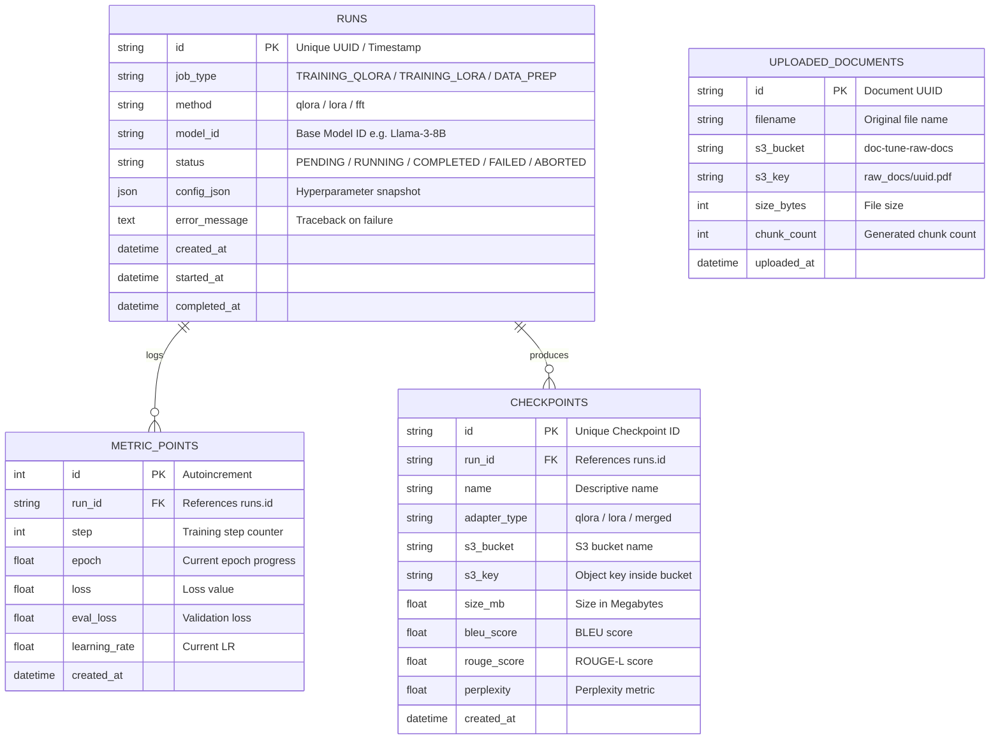

# Data Architecture & Storage Design

DocTune Studio divides storage into **Structured Relational Metadata (PostgreSQL)** and **High-Volume Binary Object Storage (MinIO S3)**.

---

## 1. PostgreSQL Relational Entity Relationship Diagram (ERD)



---

## 2. MinIO S3 Bucket Hierarchy

```
MinIO Object Storage/
├── doc-tune-raw-docs/
│   ├── raw_documents/company_policy_v2.pdf
│   └── raw_documents/financial_report_2025.docx
├── doc-tune-datasets/
│   ├── 2026-11-04_run_1/private_docs.jsonl
│   └── 2026-11-04_run_1/eval_docs.jsonl
├── doc-tune-checkpoints/
│   └── run_1730732800/
│       ├── adapter_model.safetensors    (168 MB)
│       ├── adapter_config.json          (1.2 KB)
│       ├── special_tokens_map.json      (500 B)
│       └── tokenizer.json               (9.1 MB)
└── doc-tune-merged-models/
    └── run_1730732800_merged_16bit/
        ├── model-00001-of-00004.safetensors
        ├── model.safetensors.index.json
        └── config.json
```
