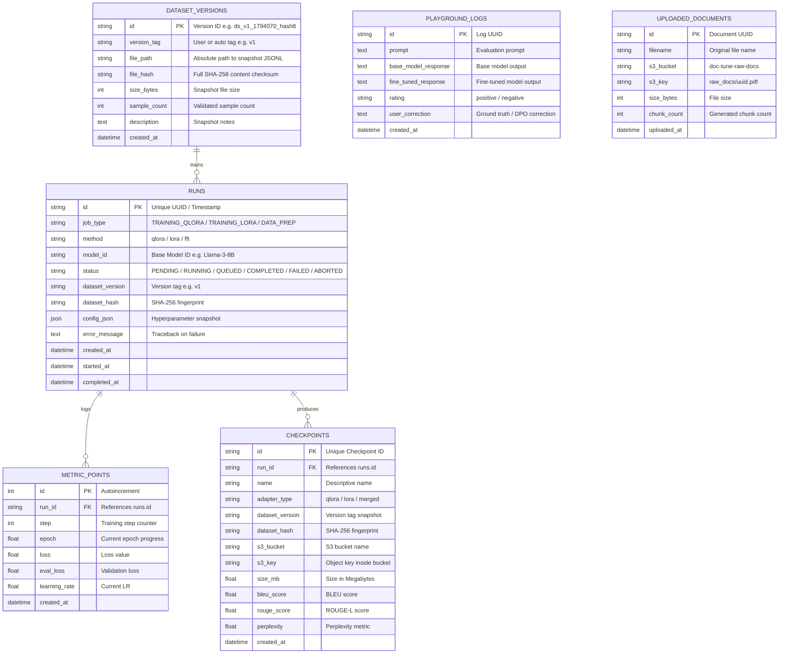

# Data Architecture & Storage Design

DocTune Studio divides storage into **Structured Relational Metadata (PostgreSQL)** and **High-Volume Binary Object Storage (MinIO S3)**.

---

## 1. PostgreSQL Relational Entity Relationship Diagram (ERD)



---

## 2. MinIO S3 Bucket Hierarchy

```
MinIO Object Storage/
├── doc-tune-raw-docs/
│   ├── raw_documents/company_policy_v2.pdf
│   └── raw_documents/financial_report_2025.docx
├── doc-tune-datasets/
│   ├── 2026-11-04_run_1/private_docs.jsonl
│   └── 2026-11-04_run_1/eval_docs.jsonl
├── doc-tune-checkpoints/
│   └── run_1730732800/
│       ├── adapter_model.safetensors    (168 MB)
│       ├── adapter_config.json          (1.2 KB)
│       ├── special_tokens_map.json      (500 B)
│       └── tokenizer.json               (9.1 MB)
└── doc-tune-merged-models/
    └── run_1730732800_merged_16bit/
        ├── model-00001-of-00004.safetensors
        ├── model.safetensors.index.json
        └── config.json
```

---

## 3. Embedded Vector Store Architecture (ChromaDB + SQLite/HNSW)

DocTune Studio uses an in-process, zero-container vector storage engine implemented via `chromadb.PersistentClient`.

```
data/vectorstore/
├── chroma.sqlite3          # SQLite relational metadata (collections, documents, chunk offsets)
└── [uuid]/                 # HNSW binary vector indices (L2/cosine dense embeddings)
    ├── data_level0.bin
    ├── header.bin
    ├── hex_index.bin
    └── link_list.bin
```

### Storage Characteristics

| Parameter | Value | Purpose |
| :--- | :--- | :--- |
| **Persistence Engine** | SQLite + HNSW (`chromadb.PersistentClient`) | In-process relational + vector persistence |
| **Mount Path** | `./data/vectorstore/` | Mounted on host and container `/app/data/vectorstore` |
| **Container Footprint** | **0 additional containers** | Runs directly within `doctune-web` / worker threads |
| **Collection Partitioning** | `doctune_{project_id}` | Strict multi-tenant isolation per project |
| **Dense Embedder** | `BAAI/bge-small-en-v1.5` (384-d) | Local CPU/GPU sentence embeddings |
| **Lexical Index** | Dynamic in-memory BM25 | Fast token-frequency search combined via RRF ($k=60$) |

### Chunk Metadata Schema

Each indexed chunk in ChromaDB is annotated with verifiable citation metadata:

```json
{
  "chunk_id": "chunk_042_a1b2c3d4",
  "doc_id": "doc_998",
  "document_name": "2026_Corporate_Failover_SOP.pdf",
  "chunk_index": 42,
  "byte_start": 12480,
  "byte_end": 14120,
  "token_count": 486,
  "sha256_hash": "e3b0c44298fc1c149afbf4c8996fb92427ae41e4649b934ca495991b7852b855",
  "project_id": "default"
}
```

