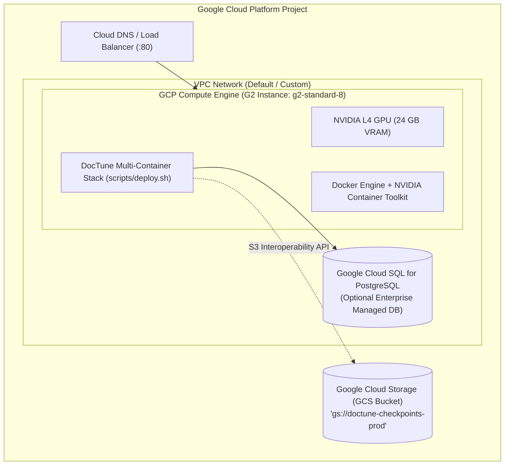

# Deployment Architecture: Local Testing & Google Cloud Platform (GCP)

DocTune Studio follows a **Local-First, Cloud-Identical Deployment Model**. The exact same Docker Compose orchestration, container layers, and environment parameters that run on your development machine deploy directly onto **Google Cloud Platform (GCP)**.

---

## 1. Local Testing Environment

* **Target Hardware**: Local development machine or on-premise workstation.
* **Orchestration**: Docker Compose v2 via [`scripts/deploy.sh`](../../scripts/deploy.sh).
* **GPU Detection**: Automatic. If an NVIDIA GPU with Container Toolkit is detected, PyTorch claims it; otherwise, the Celery worker falls back automatically to multi-threaded CPU execution (`TORCH_NUM_THREADS=7`).
* **Object Store**: Local MinIO container with data mounted on `doctune_minio_data` Docker volume.

---

## 2. Google Cloud Platform (GCP) Target Architecture



---

## 3. Provisioning on GCP Compute Engine (Step-by-Step)

### Step 1: Create a GPU-Accelerated VM (NVIDIA L4 24GB VRAM)
Run the following Google Cloud SDK command:

```bash
gcloud compute instances create doctune-studio-prod \
    --project="YOUR_GCP_PROJECT_ID" \
    --zone="us-central1-a" \
    --machine-type="g2-standard-8" \
    --accelerator="type=nvidia-l4,count=1" \
    --maintenance-policy="TERMINATE" \
    --boot-disk-size="100GB" \
    --boot-disk-type="pd-ssd" \
    --image-family="common-cu121-debian-11-py310" \
    --image-project="deeplearning-platform-release" \
    --metadata="install-nvidia-driver=True" \
    --tags="http-server,https-server,doctune-studio"
```

### Step 2: Open Firewall for DocTune Studio Port 80 & Auxiliary Services
```bash
gcloud compute firewall-rules create allow-doctune \
    --direction=INGRESS \
    --priority=1000 \
    --network=default \
    --action=ALLOW \
    --rules=tcp:80,tcp:443,tcp:9001,tcp:8888 \
    --source-ranges=0.0.0.0/0 \
    --target-tags="doctune-studio,http-server" \
    --description="Allow HTTP (80), HTTPS (443), MinIO Console (9001), and Dozzle (8888)"
```

### Step 3: Connect and Run One-Click Deployment
```bash
# SSH into the instance
gcloud compute ssh doctune-studio-prod --zone="us-central1-a"

# Clone repository
git clone https://github.com/Niccher/DocTune.git
cd DocTune

# Run automated deployment
bash scripts/deploy.sh
```

---

## 4. Swapping MinIO for Google Cloud Storage (GCS)

DocTune uses the standard AWS S3 API (`boto3`). Google Cloud Storage provides native **S3 Interoperability**:

1. In the GCP Console, go to **Cloud Storage $\to$ Settings $\to$ Interoperability**.
2. Click **Create a key** to obtain an `Access Key` and `Secret Key`.
3. In your `.env` on GCP, simply update:
   ```env
   S3_ENDPOINT_URL=https://storage.googleapis.com
   S3_ACCESS_KEY=GOOG1E...
   S3_SECRET_KEY=wJalrXUtnFEMI...
   S3_BUCKET_CHECKPOINTS=my-gcp-checkpoints-bucket
   ```
The application will immediately stream checkpoints directly into your native Google Cloud Storage bucket without requiring any code changes!
