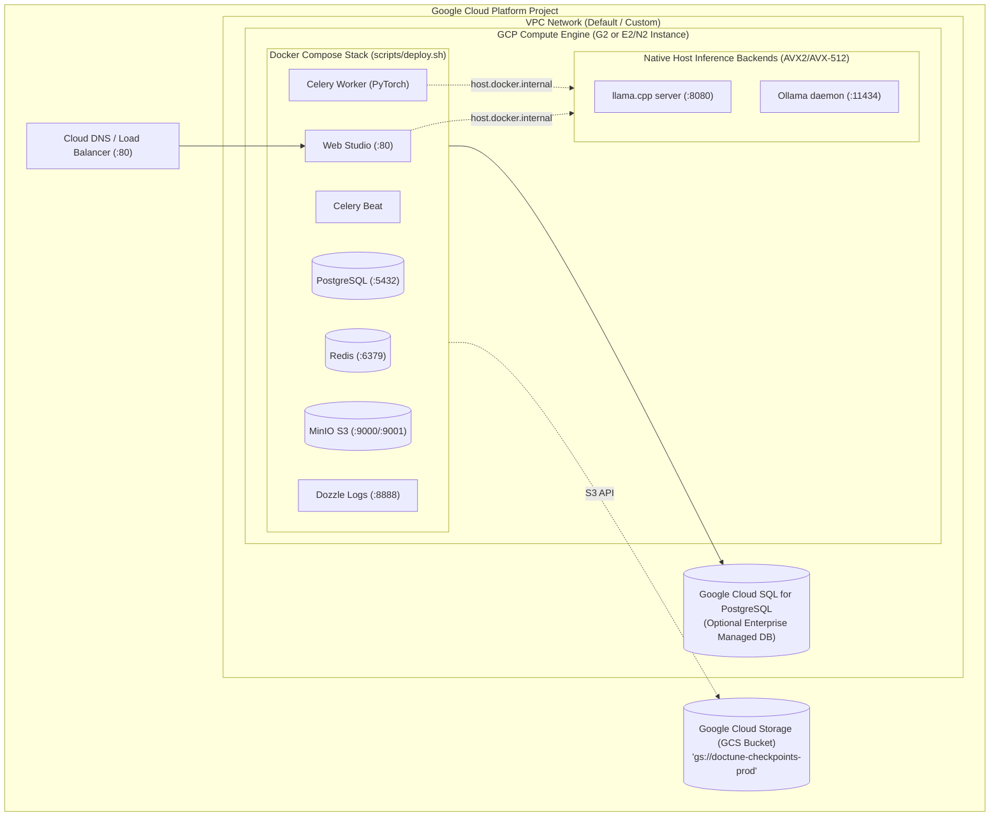

# Deployment Architecture: Local Testing & Google Cloud Platform (GCP)

DocTune Studio follows a **Local-First, Cloud-Identical Deployment Model**. The exact same Docker Compose orchestration, container layers, and environment parameters that run on your development machine deploy directly onto **Google Cloud Platform (GCP)**.

---

## 1. Unified Deployment Architecture & CLI Orchestrator

DocTune Studio provides a **Single Master Entry Point** via [`scripts/deploy.sh`](../../scripts/deploy.sh) that orchestrates both containerized services (PostgreSQL, Redis, MinIO S3, Web Studio, Celery Workers, Dozzle) and zero-overhead native host inference runners (**llama.cpp** and **Ollama**).

### Deployment Modes & Diagnostic Audit
```bash
# 0. Pre-Flight System & Hardware Audit (Run before deploying)
bash scripts/deploy.sh audit

# 1. Standard Core Stack (Default: Cloud Teacher / Standby mode)
bash scripts/deploy.sh

# 2. Full Stack + Local llama.cpp OpenAI Gateway (Port 8080, Qwen 2.5 1.5B GGUF)
bash scripts/deploy.sh --with-llamacpp

# 3. Force CPU or GPU Build (Auto-detected if omitted)
bash scripts/deploy.sh --cpu --with-llamacpp    # Ultra-lightweight ~1.4GB worker; saves ~10GB disk
bash scripts/deploy.sh --cuda --with-llamacpp   # Full NVIDIA CUDA 12 stack for GPU VMs

# 4. Full Stack + Local Ollama Daemon (Port 11434, qwen2.5:1.5b)
bash scripts/deploy.sh --with-ollama

# 5. Clean Redeployment (resets transient containers while preserving database state)
bash scripts/deploy.sh --hard-reset
```

### Direct Modular Runner Lifecycle Control
Operators can manage individual local inference engines directly through the master CLI:
```bash
# llama.cpp management (Port 8080)
bash scripts/deploy.sh llamacpp start
bash scripts/deploy.sh llamacpp status
bash scripts/deploy.sh llamacpp logs
bash scripts/deploy.sh llamacpp stop

# Ollama management (Port 11434)
bash scripts/deploy.sh ollama start
bash scripts/deploy.sh ollama status
bash scripts/deploy.sh ollama logs
bash scripts/deploy.sh ollama pull-model --model qwen2.5:1.5b
bash scripts/deploy.sh ollama stop
```

### Port Layout & Container Networking
* **Web Studio & UI**: Port `80` (HTTP)
* **PostgreSQL Database**: Port `5432`
* **Redis Message Broker**: Port `6379`
* **MinIO S3 API / Console**: Ports `9000` / `9001`
* **Dozzle Log Streaming**: Port `8888`
* **llama.cpp Host Server**: Port `8080` (accessible from containers via `http://host.docker.internal:8080/v1`)
* **Ollama Host Daemon**: Port `11434` (accessible from containers via `http://host.docker.internal:11434/v1`)

> [!TIP]
> **Performance & Low Memory Advantage**: Running `llama.cpp` and `Ollama` natively on the host rather than inside container virtualization preserves full CPU AVX2/AVX-512 hardware vectorization, saves ~1.5 GB of container daemon memory overhead, and protects 2-core / 6 GB cloud VMs from Out-Of-Memory (OOM) kernel panics.

---

## 2. Google Cloud Platform (GCP) Target Architecture



---

## 3. Provisioning on GCP Compute Engine (Step-by-Step)

### Step 1: Create a GPU-Accelerated VM (NVIDIA L4 24GB VRAM)
Run the following Google Cloud SDK command:

```bash
gcloud compute instances create doctune-studio-prod \
    --project="YOUR_GCP_PROJECT_ID" \
    --zone="us-central1-a" \
    --machine-type="g2-standard-8" \
    --accelerator="type=nvidia-l4,count=1" \
    --maintenance-policy="TERMINATE" \
    --boot-disk-size="100GB" \
    --boot-disk-type="pd-ssd" \
    --image-family="common-cu121-debian-11-py310" \
    --image-project="deeplearning-platform-release" \
    --metadata="install-nvidia-driver=True" \
    --tags="http-server,https-server,doctune-studio"
```

### Step 2: Open Firewall for DocTune Studio Port 80 & Auxiliary Services
```bash
gcloud compute firewall-rules create allow-doctune \
    --direction=INGRESS \
    --priority=1000 \
    --network=default \
    --action=ALLOW \
    --rules=tcp:80,tcp:443,tcp:9001,tcp:8888 \
    --source-ranges=0.0.0.0/0 \
    --target-tags="doctune-studio,http-server" \
    --description="Allow HTTP (80), HTTPS (443), MinIO Console (9001), and Dozzle (8888)"
```

### Step 3: Connect and Run One-Click Deployment
```bash
# SSH into the instance
gcloud compute ssh doctune-studio-prod --zone="us-central1-a"

# Clone repository
git clone https://github.com/Niccher/DocTune.git
cd DocTune

# Run automated deployment
bash scripts/deploy.sh
```

---

## 4. Swapping MinIO for Google Cloud Storage (GCS)

DocTune uses the standard AWS S3 API (`boto3`). Google Cloud Storage provides native **S3 Interoperability**:

1. In the GCP Console, go to **Cloud Storage $\to$ Settings $\to$ Interoperability**.
2. Click **Create a key** to obtain an `Access Key` and `Secret Key`.
3. In your `.env` on GCP, simply update:
   ```env
   S3_ENDPOINT_URL=https://storage.googleapis.com
   S3_ACCESS_KEY=GOOG1E...
   S3_SECRET_KEY=wJalrXUtnFEMI...
   S3_BUCKET_CHECKPOINTS=my-gcp-checkpoints-bucket
   ```
The application will immediately stream checkpoints directly into your native Google Cloud Storage bucket without requiring any code changes!
